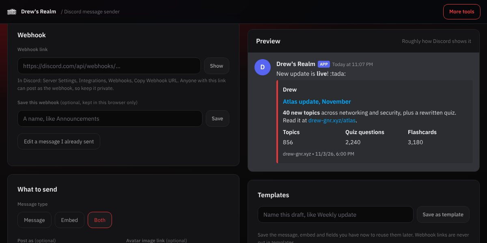

# Discord message sender

Send and edit Discord webhook messages with embeds, with a live preview. Live at <https://messagesender.drew-gnr.xyz/>.

## Features

- Plain message, embed, or both
- Custom name and avatar for the post
- Embed with title, link, description, colour, author, thumbnail, image, footer, timestamp and up to 25 fields
- Fields can be moved up and down or removed without losing what's typed in the others
- Live preview in Discord's style, with bold, italic, underline, strikethrough, inline code, code blocks, quotes and links
- Every Discord limit is checked before sending (2000 message characters, 6000 per embed, 25 fields and the rest), with the problem shown next to the field
- Sends with `?wait=true`, so you get the message id back. "Edit this one next" switches straight to editing it
- Edit mode takes a message link or id and updates the message with `PATCH`
- Thread webhooks (`?thread_id=`) are kept
- JSON panel to copy the payload or load one back in
- Save webhooks under names like "Announcements" or "Logs" and switch between them with one click (up to 20)
- Templates: save the message, embed and fields under a name and load them back later (up to 30). Templates never include a webhook link
- Draft saves in the browser as you type. Webhook links are only saved if you save them by name
- Embeds default to the site red, `#e5383b`
- Clear error messages for bad links, deleted webhooks, missing messages and rate limits
- <kbd>Ctrl</kbd>+<kbd>Enter</kbd> sends

## Privacy

Everything goes straight from your browser to Discord. Nothing passes through drew-gnr.xyz. Anyone with a webhook link can post as that webhook, so keep it private.

## Files

| Path | What it is |
| --- | --- |
| `index.html` | The page |
| `assets/payload.js` | Webhook parsing, validation and payload building, also loadable in Node |
| `assets/app.js` | Form, preview and sending |
| `assets/app.css` | Layout and the Discord-style preview |
| `assets/theme.css`, `assets/ui.js` | Shared drew-gnr.xyz look and helpers |
| `assets/fonts/` | IBM Plex, self-hosted (SIL OFL, see `OFL.txt`) |
| `tests/payload.test.js` | `node tests/payload.test.js` |

## Hosting

Static files only. `CNAME` is set for GitHub Pages.
